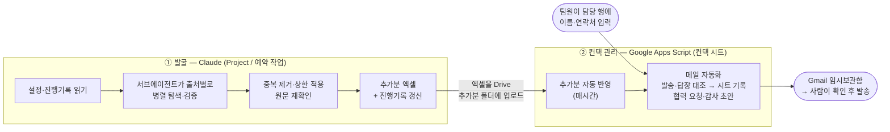

# 중소기업 컨택 자동화 템플릿

공모전·산학 프로젝트에서 **협력 제안을 보낼 중소기업을 찾고, 컨택 시트에 정리하고, 메일 초안까지 만드는** 파이프라인입니다. 서울시립대학교 직무혁신성과 공모전 생산품질팀이 2026년에 실제로 운영한 자동화를, 다음 참가 팀이 **설정값만 바꿔 쓸 수 있게** 정리했습니다.

**처음이라면 → [`SETUP.md`](SETUP.md)부터 보세요.** 코딩 없이 따라 할 수 있게 썼습니다.

## 무엇을 해 주나



1. **발굴:** 설정한 지역·인원·업종 조건에 맞는 제조기업을 공공·협회 디렉토리에서 찾아 연락처를 원문으로 검증하고, 1회 최대 N개를 엑셀로 냅니다. 어디까지 봤는지와 탈락 사유를 기록해 두고 다음 실행은 거기서 이어갑니다.
2. **반영:** 엑셀을 Drive 폴더에 올리면 컨택 시트 맨 아래에 번호를 이어 붙이고 중복 기업은 건너뜁니다.
3. **메일:** 팀원이 배정된 행마다 제안서를 첨부한 협력 요청 초안을 만들고, 보낸 메일·받은 회신을 시트에 기록합니다. 회신은 거절·수락·지연·부재중·반송으로 분류하고, 거절에는 감사 메일 초안을 만듭니다. **자동 발송은 하지 않습니다.**

## 팀마다 바꾸는 곳

| 무엇 | 어디 |
|---|---|
| 대상 지역·인원 상한·업종·우선 분야·1회 개수·상한·조회할 디렉토리 | [`config/discovery.example.json`](config/discovery.example.json) → Project에 `discovery_config.json`으로 |
| 팀명·메일 제목·메일 본문·검색 시작일 | [`apps-script/Config.gs`](apps-script/Config.gs) |
| 팀장 연락처·참조 메일·제안서 파일 | 시트 메뉴 **⚙ 초기 설정** (코드에 남지 않음) |

## 폴더

| 경로 | 내용 |
|---|---|
| [`SETUP.md`](SETUP.md) | 처음 쓰는 팀용 설정 가이드 |
| [`config/`](config) | 발굴 설정 예시와 항목 설명 |
| [`prompts/discovery_pipeline.md`](prompts/discovery_pipeline.md) | Claude에 붙여 넣는 발굴 프롬프트 |
| [`prompts/subagent_rules.md`](prompts/subagent_rules.md) | 서브에이전트 공통 규칙(통과 조건, 결과 형식) |
| [`scripts/`](scripts) | 발굴의 기계적인 부분 — 작업 파일 생성, 중복 확인, 선정, 엑셀, 기록 갱신 (Python) |
| [`apps-script/`](apps-script) | 컨택 시트에 붙이는 Apps Script 4개 파일 |
| [`tests/`](tests) | 스크립트 테스트 (가상 데이터) |
| [`data/`](data) | 기록 파일 형식과 가상 샘플 (실제 데이터는 없음) |
| [`docs/design-notes.md`](docs/design-notes.md) | 왜 이렇게 설계했는지, 한계 |
| [`prompts/archive/`](prompts/archive) | 2026년 운영 당시의 프롬프트 원문 |

## 발굴 기준 (기본 설정)

| 항목 | 기준 |
|---|---|
| 지역 | 서울·경기·인천에 사업장 또는 공장 |
| 업종 | 제조업 (도·소매, SW/SI, 컨설팅, 시공, 재생업, 해외 브랜드 판매법인 제외) |
| 규모 | 중소기업, 임직원 60명 이하 (중견·대기업·계열사·상장사 제외) |
| 연락처 | ① 원문으로 확인된 홈페이지 또는 이메일, 또는 ② 최근 12개월 활동 + 전화·이메일 |
| 원칙 | 원문 값만 기록, 출처 URL 필수, 추측·조합 금지 |

모두 설정 파일에서 바꿀 수 있습니다.

## 역할 나누기: Claude가 하는 일과 스크립트가 하는 일

판단이 필요한 일(디렉토리를 읽고 제조업인지, 같은 회사인지, 연락처가 원문인지 확인)만 Claude가 하고, 결과가 매번 같아야 하는 일은 스크립트로 고정했습니다.

| 단계 | 담당 |
|---|---|
| 제외 명단·재검토·예비후보 파일 만들기 | `prep_exclude.py` |
| 후보 탐색·검증 | Claude 서브에이전트 (`subagent_rules.md`) |
| 중복 제거, 우선순위, 상한 적용, 재확인 대상 뽑기 | `select_candidates.py` |
| 원문 재확인 | Claude (메인) |
| 엑셀 4시트 작성·검증 | `build_xlsx.py`, `validate_xlsx.py` |
| 진행기록·명단 갱신 | `update_records.py` |

## 2026년 운영 결과

- 2026년 9~10월, 컨택 시트 607번부터 1467번까지 자동으로 추가했습니다.
- 회차당 약 11분, 37~39개 통과(10월 1·2일 회차). 상한 때문에 빠진 기업은 예비후보로 다음 회차에 넘겼습니다.
- 탈락 기업 약 400곳과 사유, 조회불가 사이트 약 50곳을 기록해 같은 조회를 반복하지 않았습니다.
- 협력 기업을 선정해 공모전 과제를 진행했습니다.

## 개발자용

```bash
pip install -r requirements.txt pytest
pytest -q                                  # 발굴 스크립트 엔드투엔드 (가상 데이터)
node --test tests/apps_script.test.js      # Apps Script 순수 함수
```

로컬에서 발굴 스크립트만 돌려 보려면 [`data/README.md`](data/README.md)의 순서를 참고하세요.

## 주의

- 메일은 사람이 확인하고 보냅니다.
- 수집한 연락처는 공모전 협력 제안 목적으로만 쓰세요. 다른 목적으로 연락처를 모을 때는 개인정보보호법과 각 사이트 이용약관을 확인해야 합니다.
- 공공 디렉토리의 자동 조회 차단(robots·403)은 우회하지 않습니다.
- 이 저장소에는 실제 기업 명단·연락처가 없습니다.

## 라이선스

[MIT](LICENSE)
